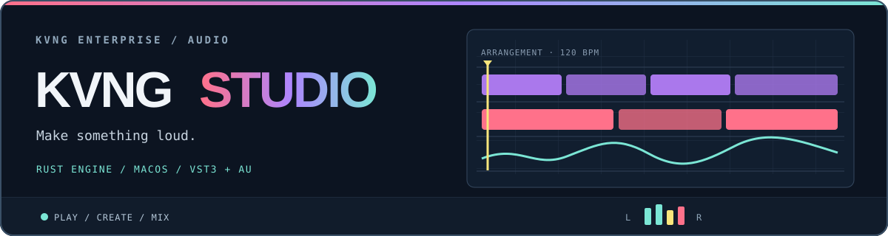

  

# KVNG Studio

**A macOS music workstation built around a Rust audio engine.** Sketch a pattern, arrange a track, shape the mix, and keep the project in an editable format. The interface is its own design; the code also includes a reader for selected FL Studio project data.

> **Development build.** This is an independent project, not an Image-Line product. FL Studio projects can contain features or plugins this app cannot reproduce, so keep a copy of the original project when importing one.

**Download:** The [v0.1.0 preview release](https://github.com/kvngC/fruity-loops-alternative/releases) contains a universal macOS app. See the [release guide](docs/RELEASE.md) for installation, verification, source, and known limits.

## What is here

| Area | Current implementation |
| --- | --- |
| Writing | Channel rack and step sequencer, piano roll, playlist clips, automation, MIDI recording, and transport controls. |
| Sound | Sampler and built-in synth, audio clips, mixer routing, built-in effects, and VST3/Audio Unit hosting through helper processes. |
| Projects | Native `.kvng` projects, autosave and recovery, sample relinking, and an `.flp` reader. |
| Export | WAV and FLAC export, stems, and offline bounce tools. |
| Workflow | Sample browser, plugin scanning, presets, mixer and piano-roll windows, and command-line inspection/rendering tools. |

The [feature matrix](docs/FL_PARITY.md) records narrower or missing areas, including MP3/OGG export and multi-output plugins. It is a development checklist, not a promise that every FL Studio project will play identically.

## Build and run

The current host and packaging scripts target **macOS 11 or newer**. Building the plugin host requires Xcode command-line tools, CMake 3.22+, Rust, and the JUCE submodule.

~~~sh
git clone --recurse-submodules https://github.com/kvngC/fruity-loops-alternative.git
cd fruity-loops-alternative
cargo run --release -p kvng-studio
~~~

If you already cloned the repository, run `git submodule update --init --recursive` before building. To open a project from the command line:

~~~sh
cargo run --release -p kvng-studio -- path/to/project.kvng
cargo run --release -p kvng-studio -- path/to/project.flp
~~~

To build a universal macOS app and a tester zip:

~~~sh
./scripts/bundle.sh
./scripts/package.sh
~~~

The scripts write `dist/KVNG Studio.app`, a versioned universal zip, and a SHA-256 checksum. The bundle is ad hoc signed and is **not notarized**. Installation notes are in [READ ME FIRST](assets/READ%20ME%20FIRST.txt).

## Useful command-line tools

~~~sh
cargo run --release -p kvng-studio -- info song.flp
cargo run --release -p kvng-studio -- convert song.flp --out song.kvng
cargo run --release -p kvng-studio -- bounce song.flp --out song.wav
cargo run --release -p kvng-studio -- scan
cargo run --release -p kvng-studio -- bench --quick
~~~

The app also has `play`, `probe`, and per-channel `render` commands; see [the CLI entry point](crates/kvng-studio/src/main.rs) for the current arguments.

## How it is organized

| Path | Responsibility |
| --- | --- |
| [`crates/kvng-studio`](crates/kvng-studio) | Desktop UI, transport, settings, and CLI. |
| [`crates/engine`](crates/engine) | Audio graph, timeline, instruments, effects, and rendering. |
| [`crates/flp`](crates/flp) | FL Studio project parsing. |
| [`crates/bridge`](crates/bridge) | Plugin scanning and isolated helper-process communication. |
| [`crates/plughost`](crates/plughost) | JUCE-based VST3 and Audio Unit host shim. |

## Checks

~~~sh
cargo test --workspace
cargo fmt --all -- --check
~~~

The plugin-host build needs the JUCE submodule even when running Rust checks. Audio-device, MIDI-device, and third-party plugin behavior need testing on the target Mac.

## Project notes

- [Feature coverage and known gaps](docs/FL_PARITY.md)
- [Tester installation notes](assets/READ%20ME%20FIRST.txt)
- [Release and source guide](docs/RELEASE.md)

## License and source

The KVNG Studio source and original assets in this repository are released under the [GNU Affero General Public License v3.0](LICENSE). JUCE is a separate pinned submodule whose modules are available under AGPLv3 or JUCE's commercial license; this project uses its AGPLv3 option. Third-party dependencies retain their own licenses. The KVNG Studio name and logo identify this project; the AGPL grant covers their copyrightable assets but does not grant trademark rights or imply endorsement.

This public repository starts with a clean source snapshot. Private research and decompilation notes are not part of the release. Build the shipped version from the matching tag using `git clone --recurse-submodules`.

The animated header is a small SVG in [`assets/readme-banner.svg`](assets/readme-banner.svg). It uses CSS only and respects reduced-motion settings.
